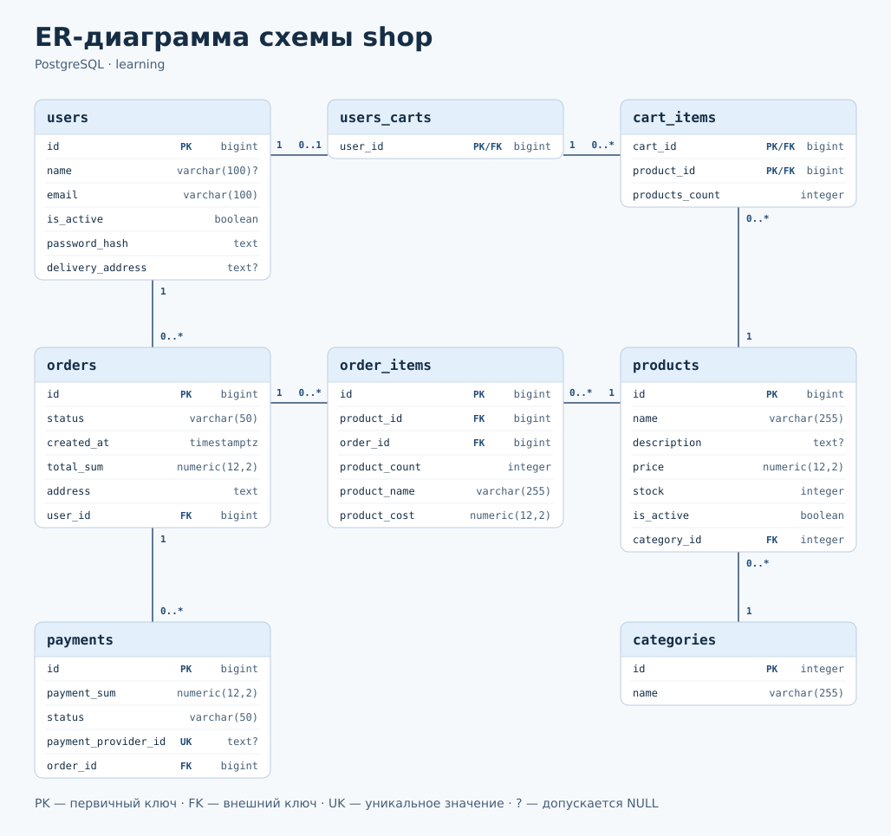

# ER-диаграмма схемы `shop`

Источник — структура схемы `shop` из локальной базы PostgreSQL `learning`, полученная через `pg_dump --schema-only`.

## Связи

Все внешние ключи обязательны. Каждая дочерняя запись ссылается ровно на одну родительскую. В последней колонке указано, сколько дочерних записей может быть у одной родительской.

| Родительский ключ | Внешний ключ | Дочерних записей |
| --- | --- | --- |
| `users.id` | `users_carts.user_id` | `0..1` корзина |
| `users.id` | `orders.user_id` | `0..*` заказов |
| `users_carts.user_id` | `cart_items.cart_id` | `0..*` позиций корзины |
| `products.id` | `cart_items.product_id` | `0..*` позиций корзин |
| `categories.id` | `products.category_id` | `0..*` товаров |
| `orders.id` | `order_items.order_id` | `0..*` позиций заказа |
| `products.id` | `order_items.product_id` | `0..*` позиций заказов |
| `orders.id` | `payments.order_id` | `0..*` платежей, из них до одного со статусом `succeeded` |

Для всех внешних ключей действуют `ON DELETE NO ACTION` и `ON UPDATE NO ACTION`. PostgreSQL отклоняет удаление родительской строки или изменение её ключа, если после операции остаются ссылки на прежний ключ.

## Ключи, проверки и значения по умолчанию

| Таблица | Правила PostgreSQL |
| --- | --- |
| `users` | Частичный уникальный индекс `user_active_email_idx` требует уникальный `email` среди активных пользователей (`is_active = true`). У неактивных пользователей email может повторяться. По умолчанию `is_active = true`. |
| `users_carts` | `user_id` одновременно первичный и внешний ключ. Корзина использует идентификатор пользователя. |
| `categories` | Первичный ключ `id`. Поле `name` обязательно, имена категорий могут повторяться. |
| `products` | `price > 0`, `stock >= 0`. По умолчанию `stock = 0`, `is_active = true`. |
| `cart_items` | Составной первичный ключ `(cart_id, product_id)` позволяет хранить один товар одной строкой в каждой корзине. `products_count > 0`. |
| `orders` | `total_sum > 0`. Допустимые статусы — `pending`, `completed`, `failed`, `cancelled`, `returned`. По умолчанию `status = 'pending'`, `created_at = now()`. |
| `order_items` | `product_count > 0`, `product_cost > 0`. Строка хранит название и цену товара в `product_name` и `product_cost`. Тот же `product_id` может встречаться в нескольких позициях одного заказа. |
| `payments` | `payment_sum > 0`. Допустимые статусы — `waiting`, `succeeded`, `failed`, `cancelled`. По умолчанию `status = 'waiting'`. Заполненный `payment_provider_id` уникален, при этом `NULL` может встречаться в нескольких строках. Частичный уникальный индекс `payments_status_succeeded_idx` ограничивает `order_id` среди платежей со статусом `succeeded`. |

`NULL` допустим только в `users.name`, `users.delivery_address`, `products.description` и `payments.payment_provider_id`. Все поля `id`, которые служат первичными ключами, определены как `GENERATED ALWAYS AS IDENTITY`.

На уровне ограничений базы корзина и заказ могут быть пустыми. Проверки количества и суммы действуют на отдельные строки. Сравнение количества с остатком товара, сверка суммы заказа с позициями и сверка суммы платежа с суммой заказа требуют отдельной логики.
